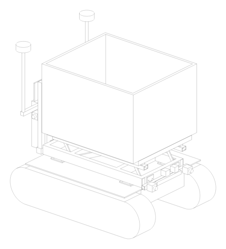
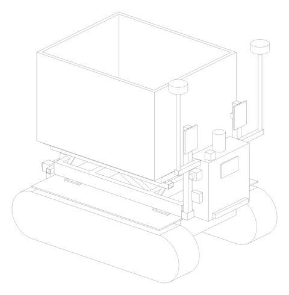
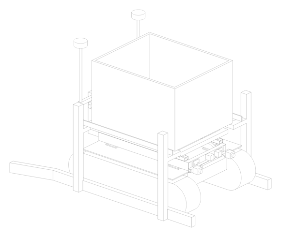
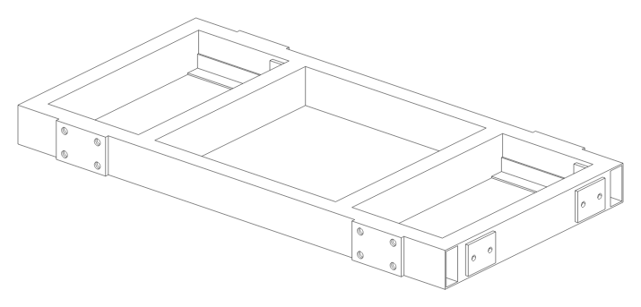

# BinBot CAD

Parametric CAD for BinBot. **All dimensions live in [`params.py`](params.py)**.
Change a number, re-run the scripts, and the 3D model, drawings and video update together.

## Bin swap video (BP‑02)

[bin_swap.mp4](out/bin_swap.mp4) (41 s, side view + section + base top view, to scale)


## Mechanical drawings

| DWG | Title | Files |
|---|---|---|
| 001 | General arrangement, robot with bin raised | [PDF](out/DWG-001_general_arrangement.pdf) · [PNG](out/DWG-001_general_arrangement.png) · [DXF](out/DWG-001_general_arrangement.dxf) |
| 002 | Top frame weldment (fabrication drawing + cut list) | [PDF](out/DWG-002_upper_frame_weldment.pdf) · [PNG](out/DWG-002_upper_frame_weldment.png) · [DXF](out/DWG-002_upper_frame_weldment.dxf) |
| 004 | Stability limits: tilt drawings + limits per load state | [PDF](out/DWG-004_stability.pdf) · [PNG](out/DWG-004_stability.png) |
| 003 | Base bin stand + clearance section (robot drives under) | [PDF](out/DWG-003_bin_stand.pdf) · [PNG](out/DWG-003_bin_stand.png) · [DXF](out/DWG-003_bin_stand.dxf) |

## Electrical drawings (BP‑04)

| DWG | Title | Files |
|---|---|---|
| E‑01 | Power distribution 48 V | [PDF](out/E-01_power.pdf) · [PNG](out/E-01_power.png) · [SVG](out/E-01_power.svg) |
| E‑02 | Safety circuit: E‑stops, contactor, brakes | [PDF](out/E-02_safety_circuit.pdf) · [PNG](out/E-02_safety_circuit.png) · [SVG](out/E-02_safety_circuit.svg) |
| E‑03 | Control & communication block diagram | [PDF](out/E-03_control_block.pdf) · [PNG](out/E-03_control_block.png) · [SVG](out/E-03_control_block.svg) |
| E‑04 | E‑box layout | [PDF](out/E-04_ebox_layout.pdf) · [PNG](out/E-04_ebox_layout.png) |

## 3D model

| File | Use |
|---|---|
| [`out/chassis_assembly.stl`](out/chassis_assembly.stl) | Robot, bin raised. Rotate it in the browser on GitHub |
| [`out/bin_stand.stl`](out/bin_stand.stl) | Base stand |
| `out/chassis_assembly.step`, `out/swap_scene.step`, `out/bin_stand.step`, `out/upper_frame.step` | Open in FreeCAD / Fusion 360 / SolidWorks |

 
 

Rev C layout: the **bought base is not modified**. Everything of ours is a top
module bolted down onto it: welded top frame, lift (2 parallel links + 1 actuator
per side), deck on 4 load cells, rear E‑box with GNSS masts (1 m apart) and beacon,
low front sensor bar (≤ 655 mm: LiDAR, E‑stops, camera) so the robot drives under
bins on the stands. No bumpers. The base in the model (centre body, top plate) is a
placeholder until the seller's drawing arrives. Collision‑checked: top module vs
base, robot vs stand in both lift positions, moving lift parts vs frame.

## Status

**PRELIMINARY.** Base size and top mounting points are assumed (1200 wide,
1700 long, top at 450 mm). When the seller's drawing arrives, update the `VENDOR`
values and base‑plate positions in `params.py`, re‑run, and check DWG‑002 before
cutting steel. Stand ledge positions must be checked against the real bin.

## Regenerate

```bash
pip install -r cad/requirements.txt
cd cad && python3 model.py && python3 drawings.py && python3 electrical.py && python3 stability.py && python3 animate.py
```
