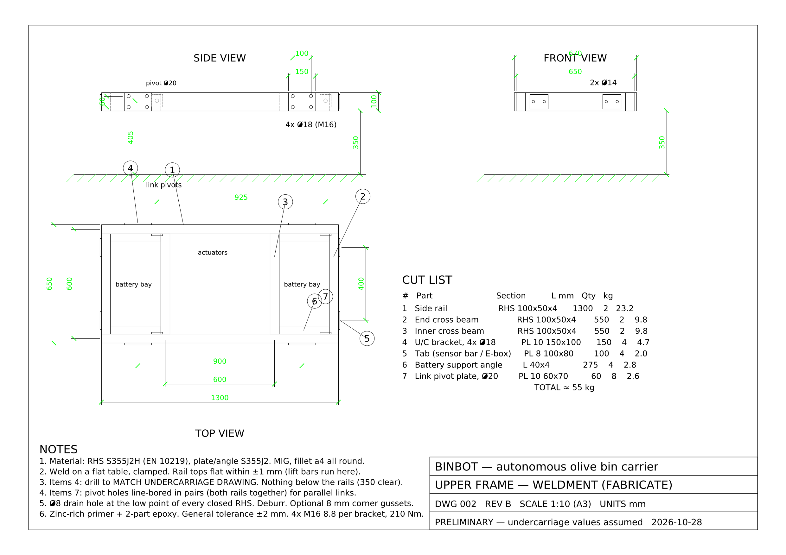

# BinBot CAD

Parametric CAD for BinBot. **All dimensions live in [`params.py`](params.py)**.
Change a number, re-run the scripts, and the 3D model and drawings update together.

## Drawings (BP‑01 chassis)

| DWG | Title | Files |
|---|---|---|
| 001 | General arrangement, chassis with bin raised | [PDF](out/DWG-001_general_arrangement.pdf) · [PNG](out/DWG-001_general_arrangement.png) · [DXF](out/DWG-001_general_arrangement.dxf) |
| 002 | Upper frame weldment (fabrication drawing + cut list) | [PDF](out/DWG-002_upper_frame_weldment.pdf) · [PNG](out/DWG-002_upper_frame_weldment.png) · [DXF](out/DWG-002_upper_frame_weldment.dxf) |

## Electrical drawings (BP‑04)

| DWG | Title | Files |
|---|---|---|
| E‑01 | Power distribution 48 V | [PDF](out/E-01_power.pdf) · [PNG](out/E-01_power.png) · [SVG](out/E-01_power.svg) |
| E‑02 | Safety circuit: E‑stops, contactor, brakes | [PDF](out/E-02_safety_circuit.pdf) · [PNG](out/E-02_safety_circuit.png) · [SVG](out/E-02_safety_circuit.svg) |
| E‑03 | Control & communication block diagram | [PDF](out/E-03_control_block.pdf) · [PNG](out/E-03_control_block.png) · [SVG](out/E-03_control_block.svg) |
| E‑04 | E‑box layout | [PDF](out/E-04_ebox_layout.pdf) · [PNG](out/E-04_ebox_layout.png) |



## 3D model

| File | Use |
|---|---|
| [`out/chassis_assembly.stl`](out/chassis_assembly.stl) | Rotate it in the browser on GitHub |
| `out/chassis_assembly.step` | Open in FreeCAD / Fusion 360 / SolidWorks |
| `out/upper_frame.step`, `.stl` | The weldment only |

  

Colours / parts in the assembly: tracks (bought undercarriage, **placeholder**),
upper frame (fabricate), lift bars + load cells + deck (BP‑02 placeholders),
battery (BP‑03 placeholder), bin, and the BP‑04/05 components: rear E‑box with
display, E‑stops, isolator and charge inlet; front sensor hoop with LiDAR, camera
and E‑stops; GNSS antenna masts front and rear; beacon; bumpers with safety
edges; lift actuators (BP‑02 placeholder).

## Status

**PRELIMINARY.** Undercarriage size and mounting points are assumed
(1200 wide, 1700 long, 400 high). When you have the seller's drawing, update
the `VENDOR` values and bracket positions in `params.py`, re‑run, and check
DWG‑002 before cutting steel.

## Regenerate

```bash
pip install -r cad/requirements.txt
cd cad && python3 model.py && python3 drawings.py && python3 electrical.py
```
