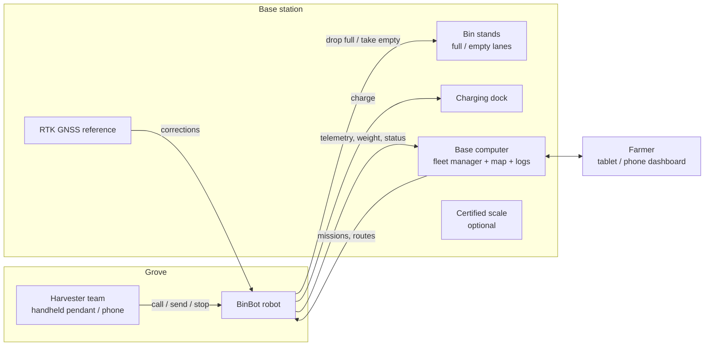
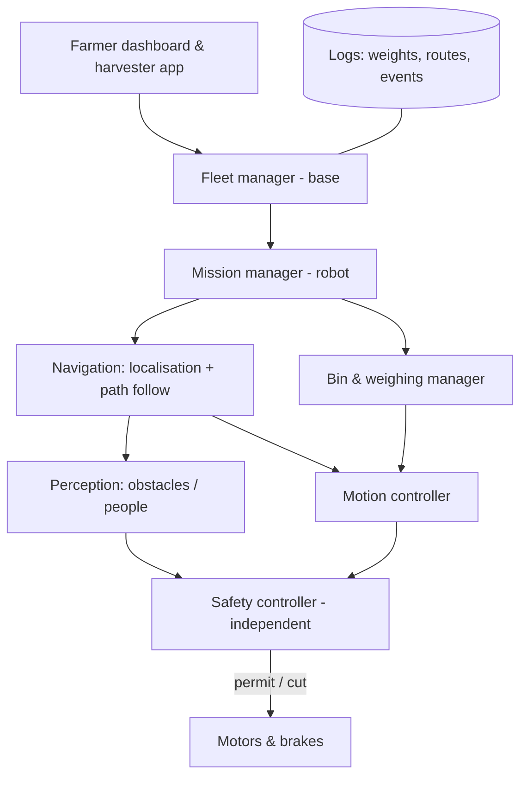
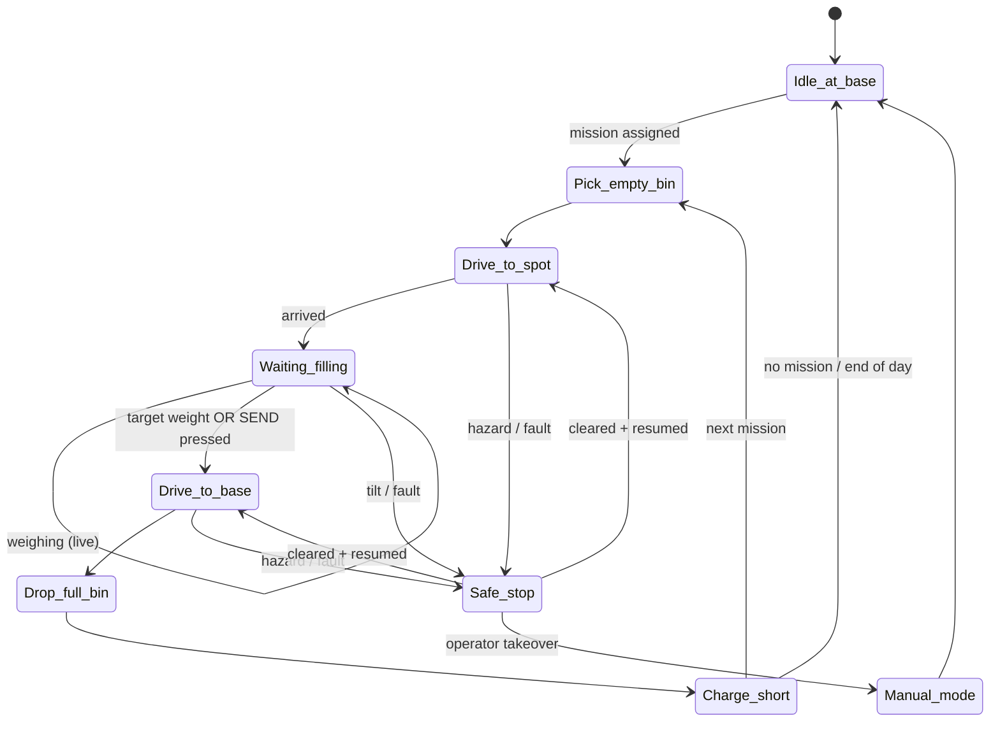

# BinBot — System Wireframe (v0.1)

Autonomous tracked bin carrier for an ~8,000‑tree olive grove in Tuscany.
This document is the **wireframe**: what the system is, how its parts connect,
how it operates, and how it stays safe. Detailed blueprints (dimensions,
parts, wiring, code) come next, one per subsystem (see §9).

> All numbers marked *(assumed)* are starting assumptions to be confirmed
> with the open questions in §10.

---

## 1. Mission in one paragraph

A tracked robot carries one harvest bin to a predefined spot in the grove.
Harvesters tip their olives into the bin while the robot weighs it
continuously. When the bin reaches its target weight (or a harvester presses
"SEND"), the robot drives back to the **base**, parks the full bin on a stand,
picks up an empty bin, and returns to the same (or next) spot. It repeats all
day, recharging briefly at every base visit.

## 2. Key requirements & starting assumptions

| Item | Target | Note |
|---|---|---|
| Grove size | ~8,000 trees ≈ 30–40 ha *(assumed 200–270 trees/ha)* | Drives route length |
| Bin | Standard ag bin 1200 × 1000 × ~750 mm, ~40 kg empty *(assumed)* | Confirm model |
| Payload | 300 kg olives + bin → **design for 400 kg** | Safety margin |
| Terrain | Mud, ruts, stones, slopes up to **30 % (≈17°)** side & front *(assumed)* | Tracks chosen for this |
| Speed | 1.5 m/s max loaded, 0.5 m/s near people / at base | |
| Endurance | Full harvest day (8–10 h) with opportunity charging at base | |
| Weighing | ±1 kg indicative on robot; certified scale at base if pickers paid by kg | See §4.3 |
| Weather | Light rain, mud, dust: **IP65** electronics, IP67 connectors | |
| Fleet | Designed for 1 robot, software ready for 2–4 | |

## 3. System overview



## 4. Robot subsystems

### 4.1 Physical layout (side view, not to scale)

```
          beacon  antennas (GNSS ×2, LTE, radio)
             ▲     ▲   ▲
   ┌─────────┴─────┴───┴─────────────┐   ← removable / open-top BIN
   │            B I N                │
   │                                 │
 ══╧═════════════════════════════════╧══ ← LIFT DECK on 4 load cells
   │  lift actuators (deck up/down)  │
 ┌─┴─────────────────────────────────┴─┐
 │ [3D LiDAR]  battery │ e‑box │ motors │[LiDAR]  ← CHASSIS (sealed bays)
 │ [bumper]                     [E‑STOP]│[bumper]
 └─╥══════════════════════════════════╥─┘
  (O)══════ rubber track L/R ══════(O)       ← 2 × CINGOLI, skid steer
```

```
 Top view
 ┌───────────────────────────────┐
 │ E‑STOP        E‑STOP          │   E‑stop buttons on all 4 corners
 │   ┌───────────────────────┐   │
 │   │      BIN (on deck)    │   │   Light bar + display on both sides
 │   └───────────────────────┘   │   (weight, state, battery)
 │ E‑STOP        E‑STOP          │
 └───────────────────────────────┘
 ◄──── track ────► ◄──── track ────►
```

### 4.2 Chassis & drivetrain (→ BP‑01)
- Steel/aluminium ladder frame, low centre of gravity (battery lowest).
- 2 rubber tracks, skid steer, ~ 250–300 mm wide for low ground pressure in mud.
- 2 × electric motors (≈ 3–5 kW each, 48 V) + gearbox, one per track, with
  **spring‑applied electric brakes** (fail‑safe: no power = braked).
- Track tensioners, mud scrapers, sealed bearings.
- Target footprint ≈ 1.4 × 1.3 m, height with bin ≈ 1.4 m *(assumed)*.

### 4.3 Bin handling & weighing (→ BP‑02)
- **Lift deck**: robot drives *under* a bin standing on a base stand, raises
  the deck ~100 mm, drives out with the bin. Reverse to drop.
  Simple, no forks to snag in the field, bin never leaves the robot in the grove.
  *(Alternative: rear forks — kept as backup option in BP‑02.)*
- Bin locating pins + side guides so the bin cannot slide on slopes.
- **4 load cells** under the deck → weight; IMU tilt compensation and
  "settle" filtering (robot stopped, no vibration) before reporting.
- Weight shown on the robot display and sent to base with GPS spot + time
  → per‑spot / per‑team yield log.
- If pickers are paid by weight: the robot value is **indicative only**; the
  official weight is taken on a certified (non‑automatic weighing instrument)
  scale at the base.

### 4.4 Power (→ BP‑03)
- 48 V LiFePO4 pack, ~10–15 kWh *(sized in BP‑03)*, with BMS.
- Opportunity charging: auto‑docking contacts at base, charges during every
  bin swap (~5–10 min).
- Separate low‑voltage rail (24/12 V) for computers & sensors.
- **Safety power path**: motor power runs through a contactor that the
  safety circuit opens (E‑stop cuts drive power, not the safety controller).

### 4.5 Electronics & compute (→ BP‑04)
| Layer | Role | Example class |
|---|---|---|
| Safety controller | E‑stop chain, bumpers, LiDAR safety fields, brake & contactor | Safety PLC / SIL‑rated relay |
| Motion controller | Motor drives, track odometry, lift actuators, load cells | Industrial MCU / PLC (CAN bus) |
| Main computer | Navigation, perception, mission logic, comms | Rugged ARM/x86 (Jetson‑class) running ROS 2 |

Main computer can **request** motion; only the safety controller can
**permit** it.

### 4.6 Navigation & perception (→ BP‑05)
- **Localisation**: dual‑antenna RTK GNSS (position + heading) fused with IMU
  and track odometry. Olive canopy degrades GNSS → add **LiDAR‑based
  localisation** against a pre‑recorded map of tree rows as fallback.
- **Route graph**: farmer drives the robot once (teach mode) along tracks
  between rows; robot only drives on these taught paths. Predefined spots =
  named nodes on the graph.
- **Obstacle & person detection**: 3D LiDAR front & rear + cameras; stops for
  people, slows for objects, re‑plans or waits if a path is blocked.
- **Terrain awareness**: IMU tilt/roll limits, track slip detection (odometry
  vs GNSS), "stuck" detection → stop and call for help.

### 4.7 Communications (→ BP‑07)
- **LTE/4G** primary (telemetry, RTK corrections via base or NTRIP).
- **Long‑range radio (LoRa / 868 MHz)** backup for heartbeat, stop and status
  where coverage is poor.
- **Handheld pendant** for harvesters: CALL, SEND, STOP (+ wireless E‑stop on
  a separate safety radio).

### 4.8 Software (→ BP‑06)



## 5. Base station (→ BP‑08)

```
              ┌─── charging dock ───┐
              │        [C]          │
   EMPTY lane │ [E][E][E][E]        │  robot drives in → lifts empty bin
   FULL  lane │ [F][F][F][F]        │  robot drives in → lowers full bin
              │  certified scale?   │  forklift/tractor clears full lane
              └── fenced, marked ───┘
   Base computer + RTK reference + LTE router + UPS in weatherproof cabinet
```
- Fixed bin stands with guides so the robot aligns itself (fiducial markers /
  reflectors for precise docking).
- Full and empty lanes separated; tractor/forklift access to the full lane
  for transport to the mill.
- Mains or solar + battery power for charging.
- Fenced zone; robot at reduced speed inside.

## 6. Operating cycle



**Weight rules** *(assumed, configurable)*: target 280 kg, hard max 350 kg
(buzzer + "STOP FILLING" on display above target, refuses to move above max).

## 7. Safety concept (→ BP‑09)

Layered: if one layer fails, the next still protects people.

| # | Layer | What it does |
|---|---|---|
| 1 | **Design** | Low CoG, limited speed, guarded pinch points on lift & tracks, no sharp edges |
| 2 | **Emergency stop** | 4 mushroom buttons on robot + wireless E‑stop on pendant + remote stop from base; hard‑wired, cuts drive power, brakes engage |
| 3 | **Fail‑safe brakes** | Spring‑applied: power loss = robot stopped and held, also on slopes |
| 4 | **Person/obstacle detection** | Safety‑rated LiDAR fields: *warning* (slow) → *protective* (stop); contact bumpers front/rear as last resort |
| 5 | **Speed & zone limits** | Slow near people, at base, in steep zones; **geofence** — never leaves taught paths |
| 6 | **Stability** | Tilt/roll limits with load‑dependent thresholds; refuses routes too steep for current weight; deck lowered while driving |
| 7 | **Overload** | Will not move above max weight; lift won't operate unless robot stopped & level |
| 8 | **Watchdogs** | Lost comms / lost localisation / software crash / sensor fault → controlled stop |
| 9 | **Awareness** | Rotating amber beacon, status light bar, buzzer before moving, display with state |
| 10 | **Operations** | Harvester briefing, high‑vis, robot never approaches a person to < 1 m, manual mode only with pendant held (dead‑man) |
| 11 | **Records** | Black‑box log of every stop, fault and near miss |

**Standards to design against** (to confirm with a certifier):
EU Machinery Regulation (EU) 2023/1230 (applies from Jan 2027),
ISO 18497 (safety of highly automated agricultural machines),
ISO 25119 (functional safety, ag machinery), ISO 13849 (safety control
systems), ISO 12100 (risk assessment), IEC 60204‑1 (electrical),
EMC & Radio Equipment Directives (CE marking).

## 8. Key risks to resolve early

1. **Traction on wet clay slopes with 400 kg** → prototype track test on your worst slope.
2. **GNSS under olive canopy** → field survey with an RTK receiver before buying sensors.
3. **Docking precision in mud at base** → gravel/concrete pad at base.
4. **Energy per day** → log a day of a tractor/ATV doing the route to size the battery.
5. **Certification effort** for an autonomous machine near workers.

## 9. Blueprint roadmap (next documents)

| ID | Blueprint | Contents |
|---|---|---|
| BP‑01 | Chassis & drivetrain | Frame drawings, track/motor sizing, traction & slope calcs |
| BP‑02 | Bin handling & weighing | Lift deck, guides, load‑cell layout, weighing algorithm |
| BP‑03 | Power system | Energy budget, battery, BMS, charging dock, power distribution |
| BP‑04 | Electronics & wiring | Block & wiring diagrams, enclosures, CAN bus, connectors |
| BP‑05 | Navigation & perception | Sensors, mounting, localisation fusion, teach & repeat |
| BP‑06 | Software architecture | ROS 2 nodes, state machine, interfaces, fleet manager |
| BP‑07 | Communications | LTE / LoRa / pendant, RTK corrections, coverage plan |
| BP‑08 | Base station | Bin stands, lanes, docking, power, layout drawing |
| BP‑09 | Safety | Hazard analysis, safety functions, PL ratings, E‑stop circuit |
| BP‑10 | Operations & HMI | Pendant, apps, dashboard, daily procedure |
| BP‑11 | Test & validation | Bench, field, safety and acceptance tests |

## 10. Open questions for the farmer

1. Exact bin model (dimensions, empty weight, how full you fill it)?
2. Steepest slope the robot must climb (loaded) and cross sideways?
3. Row spacing and width of the paths between trees?
4. Grove area (ha) and distance from the farthest spot to the base?
5. How many harvesting teams at once, and olives per team per hour?
6. Are pickers paid by weight (→ certified scale needed)?
7. Mains power available at the base? Mobile coverage across the grove?
8. One robot or several? Budget range?
9. Will it work in rain, and at dawn/dusk (lights)?
