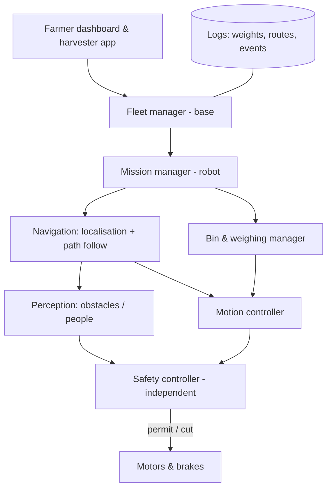
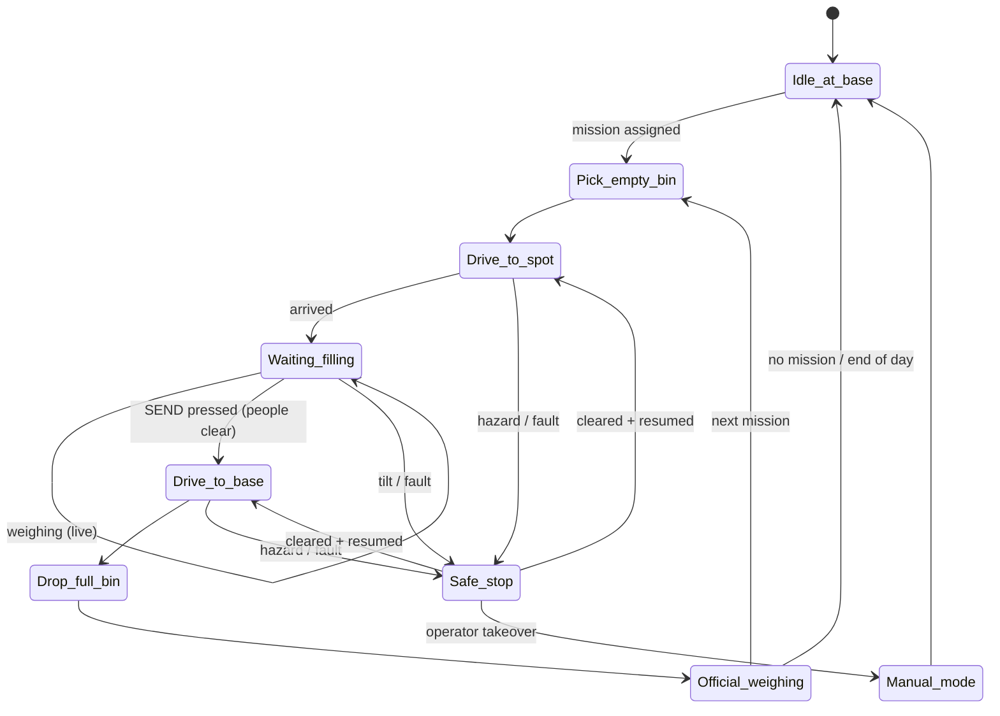

# BinBot — System Wireframe (v0.2)

Autonomous tracked bin carrier for an ~8,000‑tree olive grove in Tuscany.
This document is the **wireframe**: what the system is, how its parts connect,
how it operates, and how it stays safe. Detailed blueprints (dimensions,
parts, wiring, code) come next, one per subsystem (see §9).

> v0.2 — updated with the farmer's answers (§10) and the €8k budget (§11).

---

## 1. Mission in one paragraph

A tracked robot carries one harvest bin to a predefined spot in the grove.
Harvesters tip their olives into the bin while the robot weighs it
continuously. When the bin reaches its target weight (or a harvester presses
"SEND"), the robot drives back to the **base**, parks the full bin on a stand,
picks up an empty bin, and returns to the same (or next) spot. It repeats all
day, recharging briefly at every base visit.

## 2. Key requirements & starting assumptions

| Item | Target | Status |
|---|---|---|
| Grove | ~8,000 trees, rows 4 m apart, farthest spot ~1 km from base | confirmed |
| Bin | Standard ag bin 1200 × 1000 × ~750 mm, ~40 kg empty | confirmed |
| Payload | Up to 500 kg olives + bin → **design for 600 kg** | confirmed |
| Terrain | Mud, ruts, stones, slopes up to **25°** (≈ 47 %) | confirmed, see §8 |
| Speed | 1.0 m/s max loaded, 0.3 m/s near people / at base | lowered for safety on budget (§7) |
| Team | ~5 harvesters per spot → ~150–300 kg/h → full bin every ~2–3 h | estimate |
| Day | Daylight only, 8–10 h, ~3–5 bin trips, ≤ 10 km driven | estimate |
| Weighing | ±1 kg indicative on robot; **certified scale at base** (pickers paid by kg) | confirmed |
| Base | Mains power available | confirmed |
| Weather | Light rain, mud, dust: IP65 electronics, IP67 connectors | |
| Fleet | **1 robot** | confirmed |
| Budget | **~€8,000** | confirmed, see §11 |

## 3. System overview


## 4. Robot subsystems

### 4.1 Physical layout (side view, not to scale)

```
          beacon  antennas (GNSS ×2, LTE, radio)
             ▲     ▲   ▲
   ┌─────────┴─────┴───┴─────────────┐   ← removable / open-top BIN
   │            B I N                │
   │                                 │
 ══╧═════════════════════════════════╧══ ← LIFT DECK on 4 load cells
   │  lift actuators (deck up/down)  │
 ┌─┴─────────────────────────────────┴─┐
 │ [3D LiDAR]  battery │ e‑box │ motors │[LiDAR]  ← CHASSIS (sealed bays)
 │ [bumper]                     [E‑STOP]│[bumper]
 └─╥══════════════════════════════════╥─┘
  (O)══════ rubber track L/R ══════(O)       ← 2 × CINGOLI, skid steer
```

```
 Top view
 ┌───────────────────────────────┐
 │ E‑STOP        E‑STOP          │   E‑stop buttons on all 4 corners
 │   ┌───────────────────────┐   │
 │   │      BIN (on deck)    │   │   Light bar + display on both sides
 │   └───────────────────────┘   │   (weight, state, battery)
 │ E‑STOP        E‑STOP          │
 └───────────────────────────────┘
 ◄──── track ────► ◄──── track ────►
```

### 4.2 Chassis & drivetrain (→ BP‑01)
- **Bought electric rubber‑track undercarriage, 1.2 m wide**, with motors,
  gearboxes and brakes; upper frame welded by the farmer (BP‑01).
- 1.2 m width: safe for 25° up/down loaded; cross‑slope limited to 10° loaded.
- Climbing 25° with ~1 t total needs ≈ 2 × 2 kW motors at 0.5 m/s.
- **Spring‑applied brakes** (no power = braked), to be confirmed on the chosen undercarriage.
- Mud scrapers, sealed bearings, track tensioners.

### 4.3 Bin handling & weighing (→ BP‑02)
- **Lift deck**: robot drives *under* a bin standing on a base stand, raises
  the deck ~100 mm, drives out with the bin. Reverse to drop.
  Simple, no forks to snag in the field, bin never leaves the robot in the grove.
  *(Alternative: rear forks — kept as backup option in BP‑02.)*
- Bin locating pins + side guides so the bin cannot slide on slopes.
- **4 load cells** (≈ 300 kg each, for overload margin) under the deck → weight; IMU tilt compensation and
  "settle" filtering (robot stopped, no vibration) before reporting.
- Weight shown on the robot display and sent to base with GPS spot + time
  → per‑spot / per‑team yield log.
- Pickers are paid by weight → the robot value is **indicative only**; the
  official weight comes from a certified scale built into a base stand (§5).

### 4.4 Power (→ BP‑03)
- 48 V LiFePO4, ~7–10 kWh. Daily need ≤ 10 kWh: the robot is parked at the
  spot most of the day. Use the undercarriage's battery if one is supplied,
  lithium and big enough; otherwise buy one.
- **Charged overnight by plug at base** (mains available). Auto‑docking
  charger dropped for budget; can be added later.
- Separate low‑voltage rail (24/12 V) for computers & sensors.
- **Safety power path**: motor power runs through a contactor that the
  safety circuit opens (E‑stop cuts drive power, not the safety controller).

### 4.5 Electronics & compute (→ BP‑04)
| Layer | Role | Example class |
|---|---|---|
| Safety controller | E‑stop chain, bumpers, LiDAR safety fields, brake & contactor | Certified dual‑channel safety relay |
| Motion controller | Motor drives, track odometry, lift actuators, load cells | Industrial MCU / PLC (CAN bus) |
| Main computer | Navigation, perception, mission logic, comms | Small rugged PC / Jetson Orin Nano‑class, ROS 2 |

Main computer can **request** motion; only the safety controller can
**permit** it.

### 4.6 Navigation & perception (→ BP‑05)
- **Localisation**: dual‑antenna RTK GNSS (u‑blox F9P‑class, own reference receiver at base) (position + heading) fused with IMU
  and track odometry. Olive canopy degrades GNSS → add **LiDAR‑based
  localisation** against a pre‑recorded map of tree rows as fallback.
- **Route graph**: farmer drives the robot once (teach mode) along tracks
  between rows; robot only drives on these taught paths. Predefined spots =
  named nodes on the graph.
- **Obstacle & person detection**: one 3D LiDAR + front/rear cameras; stops
  for people, slows for objects, waits if a path is blocked. The LiDAR is
  **not safety‑rated** (budget), so it is backed by bumpers, low speed and
  operating rules (§7).
- **Terrain awareness**: IMU tilt/roll limits, track slip detection (odometry
  vs GNSS), "stuck" detection → stop and call for help.

### 4.7 Communications (→ BP‑07)
- **LTE/4G** primary (telemetry, RTK corrections via base or NTRIP).
- **Long‑range radio (LoRa / 868 MHz)** backup for heartbeat, stop and status
  where coverage is poor.
- **Handheld pendant** for harvesters: CALL, SEND, STOP (+ wireless E‑stop on
  a separate safety radio).

### 4.8 Software (→ BP‑06)



## 5. Base station (→ BP‑08)

```
              ┌─── charge plug ─────┐
              │        [C]          │
   EMPTY lane │ [E][E][E][E]        │  robot drives in → lifts empty bin
   FULL  lane │ [S][F][F][F]        │  robot lowers full bin on [S] = scale stand
              │                     │  forklift/tractor clears full lane
              └── fenced, marked ───┘
   Base computer + RTK reference + LTE router + UPS in weatherproof cabinet
```
- Fixed bin stands with guides so the robot aligns itself (fiducial markers /
  reflectors for precise docking).
- Full and empty lanes separated; tractor/forklift access to the full lane
  for transport to the mill.
- **Certified platform scale built into the first full‑bin stand**: robot
  lowers the bin, the scale records the official weight automatically with
  spot, team and time, then the robot moves on.
- Mains power: overnight charger, base computer.
- Fenced zone; robot at reduced speed inside.

## 6. Operating cycle



**Weight rules** (configurable): alert at 450 kg ("almost full"), hard max
500 kg olives (buzzer, "STOP FILLING", refuses to move above max).
The robot **never leaves on its own**: a harvester presses SEND after
checking that nobody is next to it.

## 7. Safety concept (→ BP‑09)

Layered: if one layer fails, the next still protects people.

| # | Layer | What it does |
|---|---|---|
| 1 | **Design** | Low CoG, limited speed, guarded pinch points on lift & tracks, no sharp edges |
| 2 | **Emergency stop** | 4 mushroom buttons on robot + wireless E‑stop on pendant (signal lost → stop) + remote stop from base; hard‑wired, cuts drive power, brakes engage |
| 3 | **Fail‑safe brakes** | Spring‑applied: power loss = robot stopped and held, also on slopes |
| 4 | **Person/obstacle detection** | LiDAR slow/stop zones (not safety‑rated on this budget) **plus hard‑wired contact bumpers** front/rear that cut drive power directly |
| 5 | **Speed & zone limits** | Slow near people, at base, in steep zones; **geofence** — never leaves taught paths |
| 6 | **Stability** | Tilt/roll limits with load‑dependent thresholds; refuses routes too steep for current weight; deck lowered while driving |
| 7 | **Overload** | Will not move above max weight; lift won't operate unless robot stopped & level |
| 8 | **Watchdogs** | Lost comms / lost localisation / software crash / sensor fault → controlled stop |
| 9 | **Awareness** | Rotating amber beacon, status light bar, buzzer before moving, display with state |
| 10 | **Operations** | Harvester briefing, high‑vis, robot never approaches a person to < 1 m, manual mode only with pendant held (dead‑man) |
| 11 | **Records** | Black‑box log of every stop, fault and near miss |

**Budget trade‑off:** a certified safety LiDAR (€2–4k) does not fit €8k.
Compensation: max 1 m/s, 0.3 m/s near people and base, departure only on
SEND, harvesters stay off the travel paths, bumpers and E‑stops hard‑wired.
Pickers are workers, so Italian **D.Lgs. 81/2008** applies: have the risk
assessment reviewed by your RSPP / safety consultant before use with staff.

**Standards to design against** (to confirm with a certifier):
EU Machinery Regulation (EU) 2023/1230 (applies from Jan 2027),
ISO 18497 (safety of highly automated agricultural machines),
ISO 25119 (functional safety, ag machinery), ISO 13849 (safety control
systems), ISO 12100 (risk assessment), IEC 60204‑1 (electrical),
EMC & Radio Equipment Directives (CE marking).

## 8. Key risks to resolve early

1. **25° slopes with 500 kg**: the hardest requirement. Slopes are up/down
   (confirmed). Stability is OK (BP‑01 §4), but traction on **wet** clay at 25°
   is borderline for any tracked machine (BP‑01 §5.1). Cross‑slope limited to
   10° loaded.
2. **Traction on wet clay** → test the undercarriage on your worst slope, loaded, before buying the rest.
3. **GNSS under olive canopy** → field survey with an RTK receiver before buying sensors.
4. **Docking precision in mud at base** → gravel/concrete pad at base.
5. **Budget**: €8k only with low‑end choices; battery and electronics are the main unknowns (§11, BP‑04).
6. **Worker safety compliance** (§7).

## 9. Blueprint roadmap (next documents)

| ID | Blueprint | Contents |
|---|---|---|
| [BP‑01](bp-01-chassis-drivetrain.md) | Chassis & drivetrain | Frame drawings, track/motor sizing, traction & slope calcs |
| BP‑02 | Bin handling & weighing | Lift deck, guides, load‑cell layout, weighing algorithm |
| BP‑03 | Power system | Energy budget, battery, BMS, charging dock, power distribution |
| [BP‑04](bp-04-electronics-wiring.md) | Electronics & wiring | Block & wiring diagrams, enclosures, CAN bus, connectors |
| BP‑05 | Navigation & perception | Sensors, mounting, localisation fusion, teach & repeat |
| BP‑06 | Software architecture | ROS 2 nodes, state machine, interfaces, fleet manager |
| BP‑07 | Communications | LTE / LoRa / pendant, RTK corrections, coverage plan |
| BP‑08 | Base station | Bin stands, lanes, docking, power, layout drawing |
| BP‑09 | Safety | Hazard analysis, safety functions, PL ratings, E‑stop circuit |
| BP‑10 | Operations & HMI | Pendant, apps, dashboard, daily procedure |
| BP‑11 | Test & validation | Bench, field, safety and acceptance tests |

## 10. Farmer's answers & remaining questions

Answered: bin size ✔ · payload 500 kg · slopes 25° · rows 4 m · farthest
spot ~1 km · ~5 harvesters per spot · paid by weight → certified scale ·
mains at base · daylight only · 1 robot · budget ~€8k.

Also answered: 25° is **up/down** the hill · farmer welds and wires ·
4G coverage across the grove ✔.

## 11. Budget (target €8,000, parts only, own labour)

| Item | Estimate (€) |
|---|---|
| Electric rubber‑track undercarriage 1.2 m (quoted) | **1,200** |
| Lift deck: steel + 2–4 heavy linear actuators | 500–800 |
| 4 load cells + weighing amplifier | 200–300 |
| RTK GNSS: 2 rover + 1 base receiver, antennas | 700–900 |
| Main computer | 300–600 |
| 3D LiDAR + 2 cameras | 800–1,100 |
| Electronics (BP‑04): power distribution, safety circuit, MCU, comms, E‑box, wiring | 2,300–3,700 |
| Motor controllers, only if not supplied with the drivetrain | 0–600 |
| Base: 2 bin stands + certified 600 kg platform scale | 1,000–1,600 |
| **Total** | **≈ 7,000–10,700** |

**Automatic navigation is a core requirement**, not an option. After the
detailed electronics list (BP‑04 §7) the total is **≈ €7,000–10,700**: €8k is
reachable only with low‑end choices (see BP‑04 savings). Keep ~€1k contingency.
Build order, so problems show up early and cheaply:

- **Step 1: drive base (≈ €5,200 at low‑end prices).** Undercarriage + frame, lift deck, weighing, E‑stops,
  pendant, base stands and scale. Tested by remote control to prove
  traction and stability in your mud before buying sensors.
- **Step 2: autonomy (≈ €2,000–2,600).** RTK, LiDAR, computer, software →
  the robot drives the taught routes by itself. This is the finished robot.

Not included: 48 V ~7.5 kWh LiFePO4 battery if not
supplied with the undercarriage (+€1.5–2.5k), workshop labour, safety consultant.
