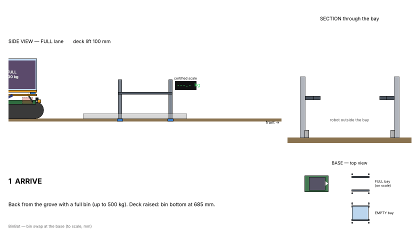

# BP‑02 — Bin Swap & Weighing (v0.1)

Part of the [BinBot wireframe](00-wireframe.md).
**Video:** [bin_swap.mp4](../cad/out/bin_swap.mp4) (41 s) · drawings: [DWG‑003 bin stand](../cad/out/DWG-003_bin_stand.pdf),
[DWG‑001 robot](../cad/out/DWG-001_general_arrangement.pdf) · 3D: [swap scene STEP](../cad/out/swap_scene.step), [stand STL](../cad/out/bin_stand.stl)

## 1. The idea

**The robot drives under a bin standing on a simple steel stand, lifts its deck
100 mm to take it, or lowers 100 mm to leave it.** No forks, no crane, nobody at
the base. The stand is open underneath and at both ends, so:
- the robot slides in under the bin;
- your tractor or forklift takes full bins out of the open front end the same way.

Two rules make it work:
1. **Everything at the front of the robot is lower than 545 mm** (LiDAR, E‑stops,
   sensor bar). The front is the only part that ever passes under a bin.
2. **Everything tall is at the rear** (E‑box, GNSS masts, beacon). The rear never
   goes under a bin: the robot leaves a full bin by **reversing** out.

## 2. Base stand (DWG‑003)

| Item | Value |
|---|---|
| Posts | 4 × SHS 80×80×4, 935 mm, on base plates, anchored |
| Ledges | 2 × RHS 100×50 laid flat, top at **635 mm**, inner edges 910 mm apart, UHMW wear strip |
| Open space between posts | 1,360 mm (tracks are 1,200: 80 mm each side) |
| Ground guides | RHS 120×60, 2 m + 0.5 m flare at the entry: centre the tracks to ±30 mm |
| Bin keepers | Flat bar 60×10 outside the ledges, stop the bin sliding sideways |
| **FULL bays** | Each post on a 1 t load cell + certified indicator (NAWI class III) → official weight logged per bin |
| **EMPTY bays** | Plain stand |
| Layout | Bays side by side, 2.2 m apart, all entries facing the same yard. Concrete or compacted gravel pad |
| Steel per stand | ≈ 146 kg |

Suggested base: **2 FULL + 2 EMPTY bays**. That's a full day for one team
without anyone touching the base until evening.

## 3. Robot lift (on the robot)

| Item | Value |
|---|---|
| Deck | 1,200 × 840 mm (narrower than the 910 mm between the ledges), UHMW strips on top |
| Heights | deck top **585 low / 685 raised**; ledges 635 → 50 mm clearance both ways |
| Mechanism | Per side: lift bar on the rail, **2 parallel links** (200 mm) in the end bays, **1 linear actuator** in the middle bay |
| Actuators | 2 × 24 V, ≥ 6 kN, 150 mm stroke, self‑locking screw, internal limit switches |
| Loads | Lifts only **empty** bins (40 kg). Full bins are only held (~2 kN) and lowered (~4 kN at touch‑down) because the links are steep at the top of the stroke |
| Side effect | Raising moves the deck 82 mm forward; the robot creeps 82 mm the other way so the bin goes straight up/down |
| Lift time | ~10 s up or down |

## 4. Weighing

- **On the robot:** 4 load cells between lift bars and deck (live weight while
  harvesters fill). Display on the E‑box: weight, "STOP FILLING" at 450 kg alert,
  refuses to move above 500 kg. Tare taken after every pickup. IMU tilt correction,
  reading taken only when the robot is still.
- **At the base:** the FULL bay's load cells give the **official weight** used to
  pay pickers. The robot's weight is only a cross‑check.
- **Self‑check during the swap:** when lowering, the robot's weight must drop to
  zero at −50 mm (bin landed). When lifting, it must rise by ~40 kg at +50 mm (bin
  picked). If not, it stops, returns the deck, and calls the farmer.

## 5. Sequence at the base

| # | Step | Sensors | Time |
|---|---|---|---|
| 1 | Arrive, bin raised | GNSS route to the bay entry point (±0.3 m) | — |
| 2 | Drive into FULL bay at 0.3 m/s | LiDAR on posts + AprilTag, ground guides | 20 s |
| 3 | Lower deck, creep 82 mm forward | load cells confirm landing; bay scale logs weight | 10 s |
| 4 | Reverse out | rear camera, safety edge | 20 s |
| 5 | Turn, line up with EMPTY bay | GNSS + LiDAR | 40 s |
| 6 | Drive in under the empty bin, deck low | LiDAR, guides | 20 s |
| 7 | Lift deck, creep 82 mm back | load cells confirm pickup, tare | 10 s |
| 8 | Drive out forward through the open front | LiDAR | 20 s |
| | **Total** | | **≈ 2.5–3 min** |

## 6. Clearances (checked in the 3D model, no collisions)

| Between | Gap |
|---|---|
| Deck (low) → empty bin on stand | 50 mm |
| Raised bin → ledges | 50 mm |
| Deck edge → ledge inner edge | 35 mm each side |
| Tracks → posts | 80 mm each side |
| Tracks → ground guides | 30 mm each side |
| Track top → ledge underside | 185 mm |
| Front parts (≤ 545) → ledge underside (585) | 40 mm |
| Ground → anything between the tracks | 350 mm |

## 7. Safety at the base

- 0.3 m/s inside the base, 0.5 m/s in the yard. Base area fenced; people stay out
  while the robot works (LiDAR stops it if someone walks in).
- Lift works only when the robot is stopped and level.
- Misaligned by > 30 mm or LiDAR doesn't see both post pairs → back out and retry
  (3 tries, then call the farmer).
- E‑stops, wireless E‑stop and the rear safety edge stay active (BP‑04 E‑02).

## 8. Cost

| Item | Est. € |
|---|---|
| EMPTY stand (steel, guides, paint) | 250–350 each |
| FULL stand + 4 load cells + certified indicator + verification | 700–1,100 each |
| **Base with 2 FULL + 2 EMPTY** | **≈ 1,900–2,900** |
| Minimum: 1 FULL + 1 EMPTY | ≈ 950–1,450 |
| Robot lift: 2 actuators, links, pins, bushes, deck, UHMW | 400–650 |
| 4 load cells + amplifier (robot) | 200–300 |

## 9. Still to confirm

1. **Bin bottom:** the ledges (y 455–555 mm from centre) and deck (±420 mm)
   must match the bin's skids or feet. Send a photo of the bin from below with
   measurements.
2. Your tractor or forklift fork height and width, to take full bins out of the
   front of the FULL bays.
3. Whether the certified scale supplier will certify the 4‑cell stand
   (usually yes, as a weighing platform with a fixed structure).
